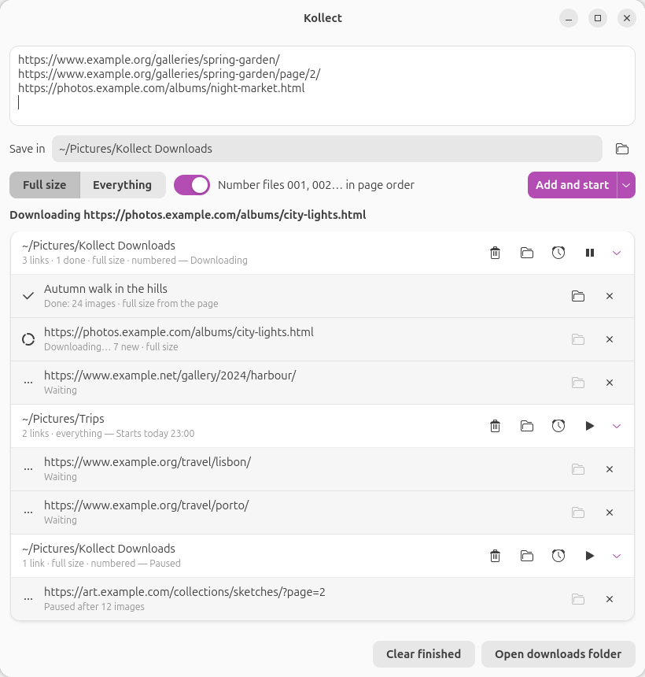
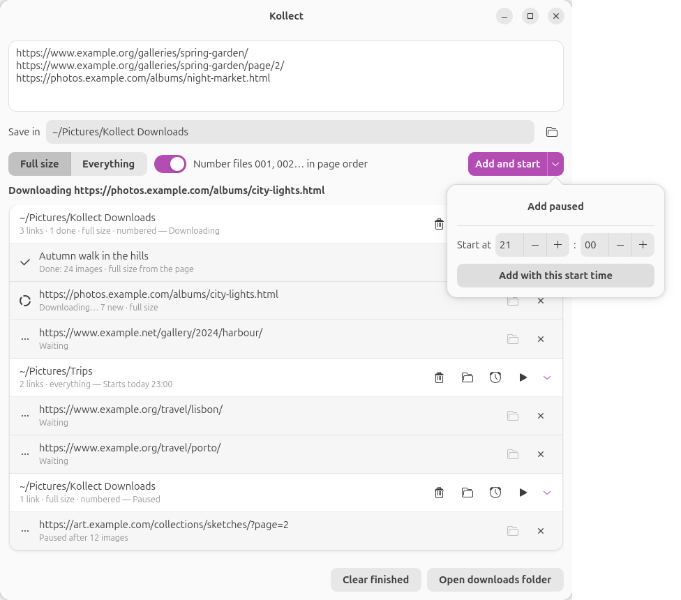
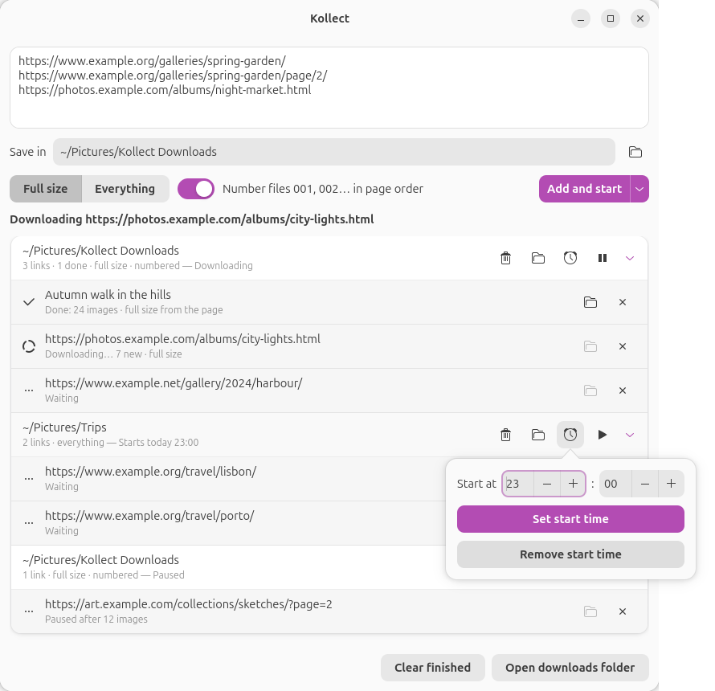

# Kollect

Kollect is a desktop window for [gallery-dl](https://github.com/mikf/gallery-dl) on Linux, made as a
Bulk Image Downloader replacement. Paste a list of gallery links, choose a folder, and Kollect
downloads the full-size pictures of every gallery, one after another, into folders named after
each page's address. It can number the pictures in page order and keeps each gallery's title,
tags, name and address in a small file and in one library spreadsheet.

Created by Kamyar Fatemifar.



## What it does

- **A queue of links.** Paste many links at once, one per line. They download one after another
  in order, more can be added while it runs, and every link shows its own progress. The queue is
  saved after every change, so it is still there after closing Kollect.
- **Batches.** The links added together form a batch with its own folder, its own Start/Pause
  button and its own start time.
- **Folders from the page address.** `https://www.example.com/galleries/summer-2024/` is saved
  in `<your folder>/example.com/galleries/summer-2024/`. Page endings such as `.html` and
  tracking parameters such as `utm_source` are left out of the folder names, and the names work
  on Linux, Windows and exFAT drives.
- **Numbering in page order.** With *Number files* on, the pictures are named `001`, `002`,
  `003`... in the order the gallery shows them. With it off, they keep the site's names.
- **Title, tags, name and address.** Each gallery folder gets a `gallery-info.json` with the
  gallery's title, tags, name, address, the list of files and everything else gallery-dl reported
  about it. Each batch folder gets a `library.csv` with one row per gallery (date, site, title,
  name, tags, address, folder, number of pictures); downloading the same address again updates
  its row.
- **Any website, full size or everything.** gallery-dl knows a long list of sites and takes their
  full-size pictures. For a site it does not know, each batch has a choice:
  - **Full size** (the default): only the large picture each thumbnail opens, at the largest size
    the page offers. Kollect reads the page, follows each thumbnail's link (lightbox galleries
    often list several sizes there, and the largest is taken), leaves out logos, icons and links
    to other galleries, and hands gallery-dl that list in page order. When the thumbnails open a
    page per photo instead, Kollect visits those pages and takes each one's main picture; when
    they open pages on an image host, gallery-dl handles those pages.
  - **Everything**: every picture on the page, with gallery-dl's generic extractor. This also
    takes the thumbnails, every size the page offers, and the page's own logos and buttons.
- **Start times.** A batch can wait for a time of day. If Kollect is closed at that time, a
  systemd user timer opens it and the batch starts.
- **Paper-simple.** One window. A link already on the clipboard is filled in when you switch to
  Kollect.

## Install

Kollect needs a Linux desktop with GTK 4.12 or newer and libadwaita 1.6 or newer (Ubuntu 24.10 or
newer, for example; it is tested on Ubuntu 26.04 with GNOME), Python 3 with PyGObject, and
gallery-dl, which is installed separately:

```bash
sudo apt install python3-gi gir1.2-gtk-4.0 gir1.2-adw-1 pipx
```

```bash
pipx install gallery-dl
```

Then install Kollect for your user (no sudo):

```bash
git clone https://github.com/kamyar94/kollect.git && cd kollect && ./install.sh
```

Kollect then appears in the app list. `./install.sh` again updates it; `./install.sh --uninstall`
removes the program and leaves your downloads, the queue and the settings in place.

## Using it

1. Paste one or more gallery links into the box, one per line.
2. *Save in* is the folder for this batch. Type a path or press the folder button.
3. Choose **Full size** or **Everything** (this matters only for sites gallery-dl does not know).
4. Turn *Number files* on to name the pictures 001, 002, 003... in page order.
5. Press **Add and start** (or Ctrl+Enter in the links box). The arrow next to it adds the batch
   paused, or with a start time.



Each batch shows its folder, how many links are done, its choices (full size or everything,
numbered) and its state, with four buttons: remove the batch from the list, open its folder, the
clock (set or remove a start time) and Start/Pause. Each link shows its progress and has buttons
to open its gallery folder and to remove it from the list. *Clear finished* removes finished rows
from the list; the downloaded files stay.



Closing Kollect while it downloads asks first; the batch is then paused and continues from where
it stopped when you press Start again. When Kollect opens, nothing starts by itself except
batches whose start time has come.

## Where files go

```
Kollect Downloads/                     the folder chosen in "Save in"
├── library.csv                        one row per gallery in this folder
└── example.com/
    └── galleries/
        └── summer-2024/
            ├── 001.jpg  002.jpg  ...
            ├── gallery-info.json
            └── .kollect/              download archive (what was already downloaded)
```

The hidden `.kollect` folder lets a second run skip the pictures it already has, even after they
were renamed to numbers. To download a gallery again from scratch, delete its folder.

Numbers follow the position on the page. When a site lists the same picture twice, the copy is
skipped and its number stays unused, so a number can be missing.

Full size works with pages that put the large picture's address in the page itself, which is how
most lightbox and photo-page galleries are built. It cannot see pictures that a page loads only
with JavaScript after it opens, and gallery-dl downloads a listed picture only when its address
ends in a picture type such as `.jpg`, `.png` or `.webp`. In those cases try Everything.

## Settings

`~/.config/kollect/settings.json` holds the last folder, Full size/Everything and numbering choices,
and two keys you can edit while Kollect is closed:

- `extra_args`: more gallery-dl options for every download. For sites that need you signed in,
  `["--cookies-from-browser", "firefox"]` uses the cookies of your Firefox profile (see
  gallery-dl's documentation for other browsers and options).
- `gallery_dl`: the full path of gallery-dl, if it is not on your `PATH` or in `~/.local/bin`.

The queue is in `~/.local/state/kollect/queue.json`, and gallery-dl's output is logged to
`~/.local/state/kollect/kollect.log`.

## Tests

```bash
python3 tests/test_core.py
```

checks folder names, numbering, metadata, the library file, start times, the saved queue and the
full-size picture finder.
`tests/atspi_drive.py` drives a running Kollect window through the accessibility bus, and
`tests/site/` has a small local test website with pictures in a known page order; its server file
explains how gallery-dl is pointed at it.

The screenshots above come from `python3 tools/screenshots.py docs/screenshots`, which opens a
separate Kollect window filled with example batches (nothing is downloaded and your own queue is not
touched) and saves it as pictures.

## License

Kollect is published under the [KF Source-Available License 1.0](LICENSE.md). You may read it,
download it, fork it and run it privately for yourself; deploying it for others, changing it or
using it commercially needs written permission. It is not an open-source license.

Kollect does not include gallery-dl or any of its code: it runs the gallery-dl program that you
install yourself. gallery-dl is made by Mike Fährmann and contributors and is licensed under the
GNU General Public License version 2. GTK, libadwaita, PyGObject and the Adwaita icons that the
window uses come from your system and keep their own licenses.
